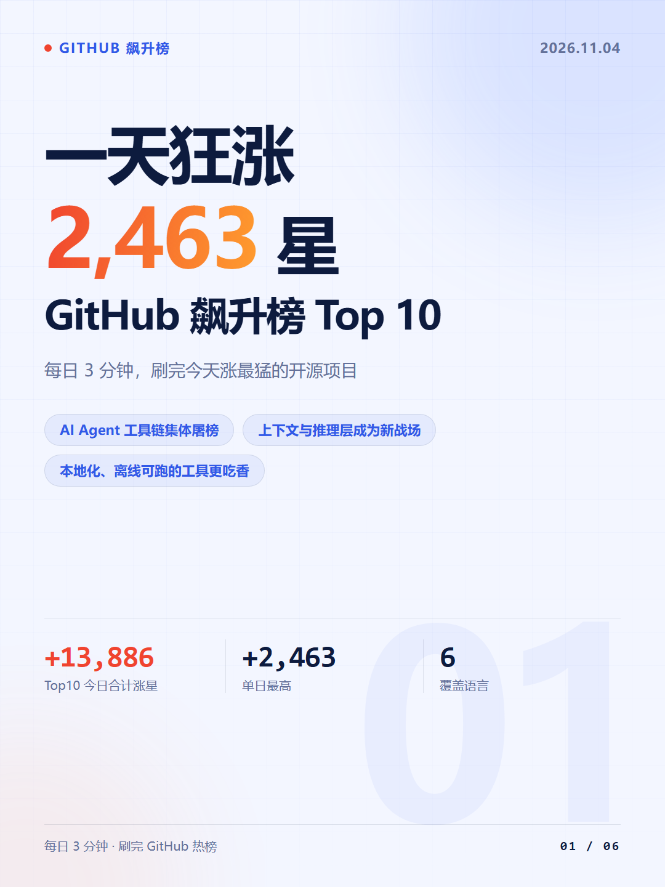
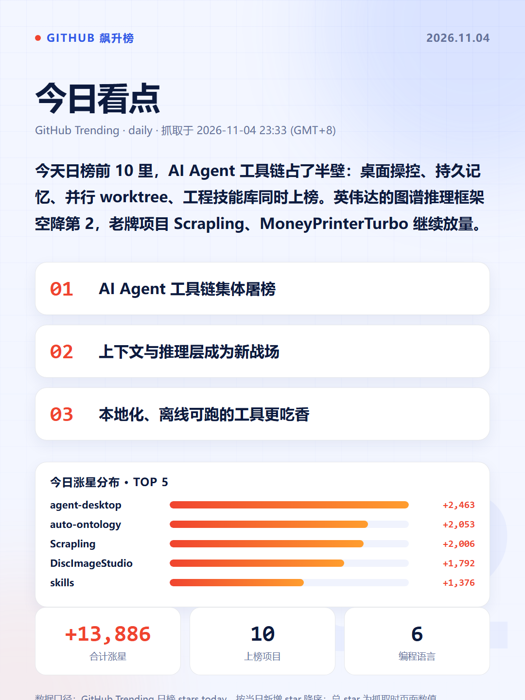
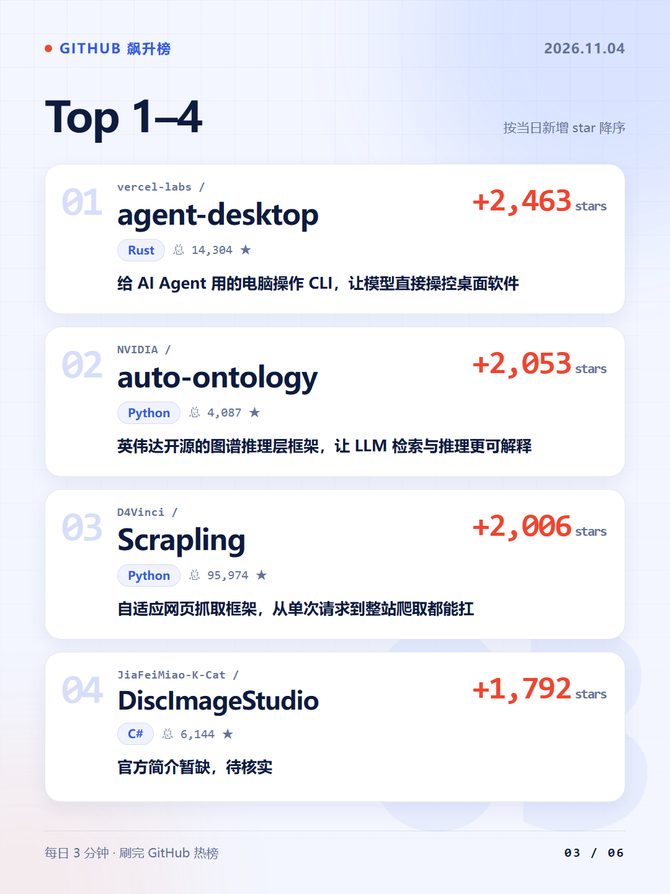

# 每日 GitHub 飙升榜 · 简报与小红书图文

每天抓一次 GitHub Trending 日榜（stars today），产出一份可读的 Markdown 简报，外加一套能直接发小红书的竖版图文卡片，同步进公众号「贴图」草稿箱，并自动同步到两个远端仓库。

数据全部来自公开页面，不编造、不用旧数据冒充当天。

## 双远端

| 平台 | 仓库 |
| --- | --- |
| GitHub | https://github.com/icecolaa/github-trending-daily |
| Gitee | https://gitee.com/ice-colaa/github-trending-daily |

本地 `origin` 指 GitHub、`mirror` 指 Gitee，`scripts/sync_remotes.py` 一次推两端，互不影响。

## 示例产物

2026-11-04：Top10 合计 **+13,886** 星，榜首 `vercel-labs/agent-desktop` 单日 **+2,463** 星。

| 封面 | 今日看点 | 榜单 |
| --- | --- | --- |
|  |  |  |

完整一套 6 张在 [`pic/20261104/xhs/`](pic/20261104/xhs/)，发布文案在 [`发布文案.md`](pic/20261104/xhs/发布文案.md)。

## 每天怎么跑

| 时间 | 位置 | 做什么 | 产物 |
| --- | --- | --- | --- |
| 08:45 | 云端 | 抓榜单，写详情报告 + 图文文案 + 结构化数据块 | 消息推送正文 |
| 09:10 | 本机 | 独立抓榜 → 出 6 张竖版图 + 1 张公众号安全封面 → 推贴图草稿 → 提交并推送双远端 | `articles/src/<日期>-github.md`、`pic/<日期>/xhs/`、`pic/<日期>/wechat/`、公众号草稿 |

云端任务关机也能跑，只推送文字；本机任务需要电脑开机，负责出图、公众号草稿与同步。

## 公众号贴图草稿

`scripts/push_wechat_newspic.py` 把当天的图按顺序推成公众号「图片消息」草稿（`article_type=newspic`）。首位是专门的 1:1「安全封面」（`pic/<日期>/wechat/公众号封面.png`），后接 6 张竖版图；发送后到公众号后台「内容与互动 → 草稿箱 → 图片」确认即可发布。

安全封面是单独出的：草稿箱列表会拿首图当缩略封面并居中裁剪放大，1080×1440 的竖版卡片贴边的字会被切掉，所以另出一张 1:1、文字全部压在中心区的图，任何比例裁切都不缺字。没有这张封面时脚本会自动退回用第一张竖版图。

| 事项 | 说明 |
| --- | --- |
| 凭证 | `~/.workbuddy/wechat-publisher.env` 里的 `WECHAT_APP_ID` / `WECHAT_APP_SECRET`，不打印、不落盘 |
| IP 白名单 | 本机出口 IP 必须加进公众号「设置与开发 → 基本配置 → IP白名单」，否则报 40164 |
| 幂等 | 同日重复运行会跳过（退出码 3）；要重建用 `--force`，建议先删旧草稿避免重复 |
| 配额 | 图片走「永久图片素材」，账号有总量上限（约 5000），一天 7 张，后台可定期清理旧素材 |
| 依赖 | 需要 `requests`；标题/描述取自当天的 `发布文案.md`，可用 `--title` / `--desc` 覆盖 |

### 合集（重要限制）

微信开放接口**没有**合集能力：`draft/add`、`draft/update`、`freepublish/*` 均无合集字段，官方社区也明确回复「合集标签需要在公众号后台手动配置」。所以脚本只能把合集名记进 `.build/wechat_drafts.json` 并在结束提示，**写不进接口**。

每日流程里这一步是：后台「内容管理 → 草稿箱」打开当天贴图 → 更多设置 → 合集 → 选「GitHub 飙升榜」→ 发表。

合集本身只需建一次：后台「内容管理 → 合集 → 创建合集」，类型选 **贴图合集**（不是文章合集；贴图内容只认贴图类型）。合集名固定用 `GitHub 飙升榜`，脚本里 `ALBUM` 常量与 `--album` 参数可改。

```bash
python scripts/push_wechat_newspic.py                 # 推当天
python scripts/push_wechat_newspic.py --date 20261105 # 补推指定日期
python scripts/push_wechat_newspic.py --dry-run       # 只校验，不调接口
python scripts/push_wechat_newspic.py --force         # 同日再推一份
python scripts/push_wechat_newspic.py --no-cover      # 不插安全封面，直接用 01-封面
```

## 目录

```
articles/src/          每日简报（Markdown + 末尾 XHS_DATA 数据块）
pic/<日期>/xhs/        当天图文：6 张 PNG、发布文案.md、预览.html、data.json
pic/<日期>/wechat/     公众号安全封面：1:1 PNG，仅用于贴图草稿首图
scripts/
  render_xhs_cards.py  榜单数据 → 1080×1440 竖版卡片 + 1080×1080 安全封面
  push_wechat_newspic.py 安全封面 + 竖版图 → 公众号图片消息草稿
  sync_remotes.py      提交并推送到多个远端
```

## 本地跑一遍

```bash
# 从简报里抠出数据块，生成整组图文
python scripts/render_xhs_cards.py --from-md articles/src/20261104-github.md

# 也可以直接喂 JSON
python scripts/render_xhs_cards.py --data articles/src/20261104-github-trending-xhs.json

# 深色主题 / 每页 3 个项目 / 指定输出目录
python scripts/render_xhs_cards.py --from-md <file> --theme dark --per-page 3 --out pic/xxx

# 推公众号贴图草稿（凭证走 ~/.workbuddy/wechat-publisher.env）
python scripts/push_wechat_newspic.py --date 20261105

# 提交并同步到所有远端
python scripts/sync_remotes.py --message "daily: 2026-11-04 GitHub 飙升榜 Top10"
```

出图依赖本机 Chrome 或 Edge 的无头截图能力，中文字体用系统微软雅黑。

## 图文规格

- 1080×1440，共 6 张：封面 / 今日看点（含 Top5 涨星条形图）/ 榜单 3 页 / 结尾
- 长仓库名自动缩字号，不折行、不截断
- 同目录附带 `发布文案.md`（标题 + 逐条点评 + 话题标签）、`预览.html`、`data.json`

## 数据口径

- 榜单口径为 GitHub Trending 日榜的 stars today，按当日新增 star 降序排列
- 总 star 为抓取时页面数值，会随时间变化
- 抓不到的字段标注「暂无数据」，不确定的标注「待核实」
- 每晚抓取后会写明数据窗口与抓取时间

## 声明

数据来自 GitHub 公开页面，本仓库只做整理与可视化，项目版权归各仓库作者所有。
